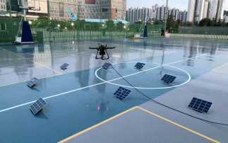

# L.E.O.N.A. | AI 비전 기반 태양광 패널 청소드론

**DA-DAKA(다닦아) 팀 · 2026 항공드론 종합설계 경진대회 및 한이음 드림업**

옥상이나 경사지의 태양광 패널은 작업자가 접근하기 어렵고, 오염이 일부에 몰려 있어도 패널 전체를 세척하는 경우가 있습니다. DA-DAKA 팀은 카메라로 패널과 오염 위치를 찾고 필요한 지점에 물을 분사하는 4축 드론 시제품을 제작했습니다. 기체 설계, 지상 급수, AI 영상 인식, 자율비행을 하나의 세척 임무로 연결하는 것이 목표였습니다.

*태양광 패널 모형을 배치한 DA-DAKA 팀 야외 비행 시험*

## 기체 구조와 물 분사부 설계

초기에는 3D 프린팅으로 일체형 암을 제작하는 방안을 검토했습니다. Ansys 구조 해석에서 모터 장착부와 중앙 프레임 체결부에 하중이 집중되어, 암을 원형 카본 튜브로 변경했습니다. 원형 튜브는 조립할 때 모터의 수평을 맞추기 어려워 사각 PLA 마운트와 맞물리는 구조를 적용했습니다. 이 구조로 암의 회전 유격을 줄이고 모터를 일정한 각도로 조립할 수 있게 했습니다. 최종 시제품은 PLA+ 중앙 프레임과 카본 튜브 암을 사용했으며, 기체 중량은 약 2.8 kg이었습니다.

기체에 물을 싣는 부담을 줄이기 위해 물탱크와 펌프는 지상에 배치했습니다. 지상 펌프가 호스로 세척수를 공급하고 기체에서는 솔레노이드 밸브와 노즐이 물의 흐름을 제어합니다. 반복 습식 시험에서 호스 길이와 배관 저항에 따른 분사 상태를 점검했고, 호스의 무게와 마찰력이 기체에 주는 영향을 줄이기 위해 하부 연결부를 보강했습니다.

*지상 급수 장치와 기체를 연결한 시험 구성*

## AI 영상 인식과 자율 임무

초기에는 영상의 밝기와 색상으로 오염을 판별했으나 반사광과 그림자 때문에 오검출이 발생했습니다. 최종 시스템에서는 GPU 노트북의 **Panel V4** 모델로 영상에서 패널을 찾고, 검출된 패널 내부에 **Dirt V3** 모델을 적용해 오염 영역과 중심점을 구했습니다. Raspberry Pi 5는 영상 송출, 위치 추정, 경로 생성과 임무 순서를 맡고, Pixhawk 4(PX4)는 자세 제어와 밸브 구동 명령을 수행하도록 구성했습니다.

이륙 후에는 패널 영상과 비행 고도를 바탕으로 패널의 상대 위치를 추정해 방문 경로를 만듭니다. 가까운 패널부터 방문하는 초안을 만든 뒤, 2-opt로 방문 순서를 바꿔 이동거리가 짧아지는 경로를 선택합니다. 드론은 순서대로 패널에 접근하며, 오염이 확인되면 영상 속 오염 중심과 LiDAR 거리 값을 바탕으로 분사 위치에 정렬합니다. 거리·자세·정렬 조건을 충족하면 밸브를 3초간 열고, 설계상 새 영상으로 오염 상태를 다시 확인합니다. 방문을 마치면 출발 지점으로 돌아와 자동 착륙합니다.

## 실기체 시험에서 확인한 결과

| 시험 | 결과 |
| --- | --- |
| 정지 비행과 거리 측정 | 반복 호버링 시험에서 제어 조정 후 평균 위치 오차가 14 cm에서 6 cm로 줄었습니다. LiDAR 거리 측정의 평균 절대 오차는 필터 적용 후 5.2 cm에서 2.5 cm로 줄었습니다. |
| 습식 분사 | 실제로 물을 흘려 솔레노이드 밸브의 개폐와 노즐 분사를 반복 확인했습니다. |
| 최종 야외 비행 | 패널 인식과 방문 경로 생성, 계획 경로 비행, 원점 복귀와 자동 착륙을 완료했습니다. |
| 비행 중 정밀 분사 | 분사 명령과 3초간의 분사 장치 구동을 확인했습니다. 물줄기는 목표 오염 지점을 벗어났습니다. |

팀은 정밀 분사 오차가 발생한 원인으로 영상·추론 결과의 전달 지연과 노즐 조준 오차를 검토했습니다. 후속 개선 과제로 통신 지연을 줄이고, 카메라에서 추정한 오염 위치와 실제 노즐 분사점의 차이를 다시 보정하며, 노즐 고정부의 강성을 높이는 작업을 정리했습니다.

## 내가 맡은 설계

김권우 · **Fusion 360 드론 프레임 설계**와 **물 분사부 구성 설계**를 담당했습니다. Fusion 360에서 기체 프레임을 모델링하고, 지상 펌프에서 호스와 피팅을 거쳐 솔레노이드 밸브와 노즐로 이어지는 물 공급·분사 구성을 설계했습니다.
