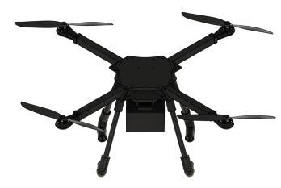
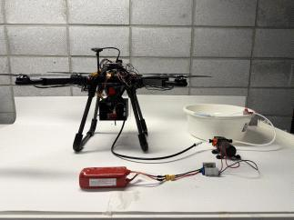
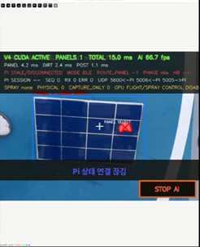
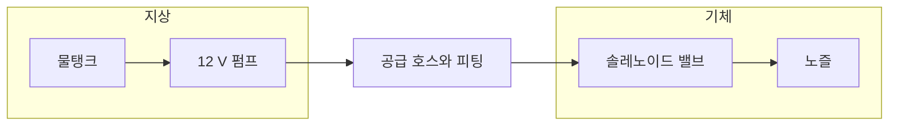

# L.E.O.N.A. | AI 비전 기반 태양광 패널 청소드론

**DA-DAKA(다닦아) · 인하대학교 팀 프로젝트 · 2026 항공드론 종합설계 경진대회 은상 및 한이음 드림업 장려상 수상**

L.E.O.N.A.는 배치가 일정하지 않은 태양광 패널을 찾아 지도를 만들고, 오염 지점에 물을 분사하도록 설계한 드론입니다. 팀은 약 2.8 kg의 4축 시제품을 제작해 야외에서 패널 인식, 경로 비행, 원점 복귀와 자동 착륙을 확인했습니다.

**담당 설계 · [Fusion 360 드론 프레임 및 물 분사부 구성](#내가-맡은-설계)**

| 시험 목표 | 확인한 결과 |
| --- | --- |
| 목표 거리 1 m 유지 | 실기체 시험 두 차례에서 각각 약 1.07 m·1.06 m 유지 |
| 3초 분사 | 최종 야외 시험에서 분사 명령과 장치 구동 확인 |
| 오염 지점 조준 | 최종 야외 시험에서 물줄기가 목표 오염 지점을 벗어남 |

[시험 조건과 상세 결과](#시험-기록과-설계-판단)

[제작설계서·보고서·시험자료](docs/README.md) · [제작·시험 사진](assets/photos/README.md)

*태양광 패널 모형을 배치한 야외 통합 시험. DA-DAKA 종합설계 최종보고서.*

## 프로젝트 배경

옥상이나 경사지에 설치한 태양광 설비는 작업자가 물과 장비를 가지고 접근하기 어렵습니다. 오염이 일부 패널이나 한 지점에 몰려 있을 때는 세척이 필요한 곳을 먼저 찾는 작업도 필요합니다. 팀은 **패널을 찾는 일, 오염 위치를 작업 좌표로 바꾸는 일, 세척 결과를 확인하는 일**을 한 기체의 임무로 연결하는 것을 목표로 잡았습니다.

2026년 7월 제작설계서에서 영상 판단, 좌표 변환, 비행 제어, 분사 허용 조건을 정의했습니다. 이후 하드웨어 조립과 호버링, 센서, GPU 통신, 분사를 따로 시험한 뒤 야외 임무로 통합했습니다.

## 하드웨어 설계와 변경 과정

### 기체 구조와 전장 배치

초기 설계는 암을 3D 프린팅하여 중앙 프레임과 결합하는 구조였습니다. 팀은 암을 **외경 18 mm 카본 튜브**로 바꾸고, 양 끝에 사각 PLA 마운트가 맞물리도록 설계했습니다. 원형 튜브가 체결부 안에서 돌아가는 유격을 줄여 네 모터의 각도를 맞추기 위한 구조였습니다.

*초기 암의 응력 해석과 최종 기체 어셈블리. 두 그림은 팀 설계 자료입니다.*

최종 기체에는 약 218 mm의 PLA+ 중앙 프레임, 700 KV 모터 4개, 13인치 프로펠러, 4S 5,000 mAh 배터리를 사용했습니다. 센서 마운트와 전장 고정부를 모듈화하고, 배선이 프로펠러나 센서 시야를 가리지 않도록 배선 경로를 정했습니다. 가장 무거운 배터리를 기체 중심 하부에 배치한 뒤 측정한 무게중심 편차는 전후 6 mm, 좌우 4 mm였습니다.

### 지상 급수와 기체 분사

초기에는 펌프와 물탱크를 기체에 싣는 방식을 검토했습니다. 물이 줄어들면 하중과 무게중심이 달라지고, 물을 다시 채울 때마다 착륙해야 하는 구조였습니다. 최종 시제품은 세척수와 펌프를 지상에 두고 호스로 공급합니다. 기체에서는 밸브가 열릴 때 노즐로 물이 나갑니다.

**지상 물탱크 → SEAFLO 12 V 펌프 → 공급 호스·피팅 → 기체의 솔레노이드 밸브 → 노즐**

지상 급수는 기체의 탑재 부담을 줄였습니다. 비행 중에는 호스의 자중과 장력, 지면 마찰을 고려해야 했습니다. 팀은 실제 물을 흘려 호스 길이와 배관 저항에 따라 분사가 달라지는 현상을 점검하고 기체 하부 연결부를 보강했습니다.

*분사 기능을 확인할 때 사용한 지상 급수 구성.*

## AI 비전과 데이터

초기에는 Raspberry Pi에서 OpenCV로 영상의 밝기와 색을 비교했습니다. 태양광 패널의 반사광과 그림자가 오염으로 검출돼, 팀은 패널 검출과 오염 분할을 두 단계로 나눴습니다. **Panel V4**는 전체 영상에서 패널의 사각형 영역을 찾고, **Dirt V3**는 그 영역 안에서 오염 픽셀을 분할합니다. 오염 마스크에서 구한 중심점은 기체가 접근할 목표를 계산하는 데 사용합니다.

CVAT에서 패널은 사각형, 오염은 다각형으로 라벨링했습니다. 같은 패널이나 연속 촬영 영상이 학습과 평가로 나뉘어 성능이 부풀려지는 문제를 줄이기 위해, 원본을 촬영 그룹 단위로 분리한 뒤 패널 영역을 잘라냈습니다. 깨끗한 패널의 이미지도 음성 샘플로 유지했습니다.

| 평가 | 기록된 결과 |
| --- | --- |
| Panel V4 패널 검출 | Recall 99.84%, mAP@0.50–0.95 0.921 |
| Dirt V3 후보 평가 · 학습에 사용하지 않은 패널 영역 이미지(ROI) 77개 | 오염 샘플 45/45 검출, 청결 샘플 31/32를 청결로 판정 |
| Dirt V3 오염 픽셀 분할 | 같은 평가 데이터의 Dice 89.36%. Dice는 예측 마스크와 정답 영역이 겹치는 정도를 나타냅니다. |

Dirt V3 후보는 개발용 데이터로 판정 기준을 정한 뒤 별도의 평가 데이터로 한 번 평가했습니다. 위 수치는 영상 모델 평가에 해당합니다. 비행 중 실제 물줄기가 목표에 닿았는지는 최종 야외 시험에서 별도로 확인했습니다.

*팀이 사용한 GPU 추론 화면. 영상 위에 검출된 패널과 오염 위치가 표시됩니다.*

## 자율비행과 분사 제어

| 구성 | 맡은 기능 |
| --- | --- |
| 하방 카메라와 TF-Luna LiDAR | 패널 영상 촬영 및 근접 작업 거리 측정 |
| NVIDIA GPU 노트북 | 영상에서 패널과 오염을 추론하고 결과를 Raspberry Pi로 전송 |
| Raspberry Pi 5 · ROS 2 Jazzy | 영상 송출, 패널 위치 계산, 경로 생성, 임무 상태 관리와 분사 조건 판정 |
| Pixhawk 4 · PX4 | MAVROS를 통해 임무 컴퓨터의 명령을 받아 자세·모터·분사 출력을 제어 |
| QGroundControl | 비행 상태 모니터링 및 비상시 개입 |

1. **탐색과 지도화** — 이륙 후 상공에서 패널을 촬영합니다. 영상 속 패널 위치, 비행 고도, 카메라 화각을 이용해 상대 좌표를 추정하고, 여러 영상에 반복 등장한 패널을 하나로 합칩니다.
2. **방문 경로 생성** — 가까운 미방문 패널부터 순서를 만든 뒤, 2-opt로 방문 순서 일부를 바꾸면서 이동거리가 줄어드는 경로를 찾습니다.
3. **접근과 조준** — 패널에 접근해 오염 여부를 다시 판정합니다. 깨끗한 패널은 지나가고, 오염 패널에는 LiDAR로 거리를 유지하면서 카메라 중심과 노즐 분사축 사이의 위치 차이를 반영해 조준합니다.
4. **선택 분사와 재확인** — 거리·자세·영상 정렬 조건을 충족하고 최신 추론 결과가 유효할 때 밸브를 3초간 엽니다. 분사 후 촬영한 새 영상으로만 결과를 판단하도록 설계했으며, 오염이 남으면 재정렬 후 패널당 최대 3회까지 분사하도록 했습니다.
5. **복귀** — 방문을 마치면 이륙 지점으로 돌아와 자동 착륙합니다.

## 시험 기록과 설계 판단

| 시험 | 조건과 결과 |
| --- | --- |
| 정지 GPS 고도 시험 · 8월 5일 | 기체를 이륙시키지 않고 60초 동안 원시 GPS 해발고도를 기록했습니다. 초기 최대·최소 차이는 16.25 m였고, GPS 설정 초기화 후에도 8.47 m로 기준 0.5 m를 넘었습니다. 같은 기록에서 LiDAR 값의 최대·최소 차이는 약 1 cm였습니다. |
| 호버링과 LiDAR 개선 | 모터 마운트·배치·무게중심을 먼저 점검한 뒤 실기체 로그로 자세 제어값을 조정했습니다. 반복 호버링의 평균 위치 오차는 14 cm에서 6 cm로 감소했습니다. 별도 거리 시험에서 LiDAR 평균 절대 오차는 필터 적용 후 5.2 cm에서 2.5 cm로 감소했습니다. |
| GPU 연결 시험 · 8월 16일 | Pi에서 보낸 영상의 추론 결과가 돌아오는 것을 확인했습니다. 오염 확인 모드에서 GPU 추론은 약 5.2 ms, 결과 수신률은 약 19.5 Hz였습니다. 5.2 ms는 추론에 걸린 시간입니다. |
| 1 m 거리 제어 · 8월 21일 | 독립된 실기체 시험 2회에서 거리 제어와 착륙을 완료했습니다. 1 m를 목표로 유지한 거리는 각각 약 1.07 m, 1.06 m였습니다. |
| 분사 회로와 습식 벤치 시험 | 밸브를 12 V에 직접 연결했을 때 물이 나왔고, DRV8876을 경유하면 작동음만 났습니다. 구동 전류 제한과 비행제어기 출력을 점검한 뒤, 최종 습식 시험에서 한 번의 명령으로 약 3초간 분사하고 이후 유로가 닫히는 것을 확인했습니다. |
| 최종 야외 통합 시험 | 패널 인식과 방문 경로 생성, 목표 패널 접근, 원점 복귀와 자동 착륙을 수행했습니다. 비행 중 3초 분사 명령에 장치가 작동했고 물줄기는 목표 오염 지점을 벗어났습니다. |

## 정밀 분사에서 남은 과제

최종 시험에서는 영상에서 계산한 오염 중심과 실제 물줄기가 닿는 위치 사이에 오차가 있었습니다. 팀은 카메라와 노즐 사이의 위치 차이를 다시 보정하고, 노즐 고정부가 흔들리는 정도와 분사 폭·유량을 점검할 필요가 있다고 정리했습니다. 무선망의 지연과 지터도 후보 원인으로 남았습니다. 한이음 개발보고서에서는 통신 지연을 별도로 기록한 뒤 기계적 조준 오차와 영향을 구분하는 후속 시험을 제안했습니다.

현장 적용을 검증하려면 같은 위치에서 반복 분사해 목표에 닿는 비율과 오염 제거율을 기록하고, 전체 세척 방식과 동일한 조건에서 실제 물 사용량과 작업 시간을 비교해야 합니다. 호스가 기체의 이동 범위와 반복 작업에 주는 영향도 함께 확인할 항목입니다.

## 내가 맡은 설계

김권우 · **Fusion 360 드론 프레임 설계**와 **물 분사부 구성 설계**를 맡았습니다. Fusion 360으로 기체 프레임을 모델링했고, 지상 펌프에서 호스와 피팅을 거쳐 솔레노이드 밸브와 노즐까지 이어지는 물 공급·분사 구성을 설계했습니다.

*최종보고서의 급수 구성을 바탕으로 정리한 분사부 계통도.*

## 제작·시험 사진

| 조립 기체 상면 | 기체 하부의 물 분사 모듈 |
| --- | --- |
|  |  |

지상 급수 벤치, 야외 시험 장면, 오염 인식 화면은 [제작·시험 사진 모음](assets/photos/README.md)에서 볼 수 있습니다.

## 첨부 자료

| 자료 | 파일 |
| --- | --- |
| 한이음 제작설계서 | [PPTX](docs/haniium-design-specification.pptx) |
| 한이음 개발보고서 최종본 v2 | [PDF](docs/haniium-development-report-v2.pdf) |
| 종합설계경진대회 최종보고서 본문 | [PDF](docs/aircraft-drone-final-report.pdf) |
| 종합설계경진대회 최종 발표자료 | [PPTX](docs/competition-presentation.pptx) |
| GPS 고도 현장시험 결과 | [CSV](docs/tests/gps-altitude-field-test-results.csv) |

수행계획서, 기체 설계 작성본, 포스터와 나머지 시험 기록은 [전체 첨부 자료](docs/README.md)에 모았습니다.
