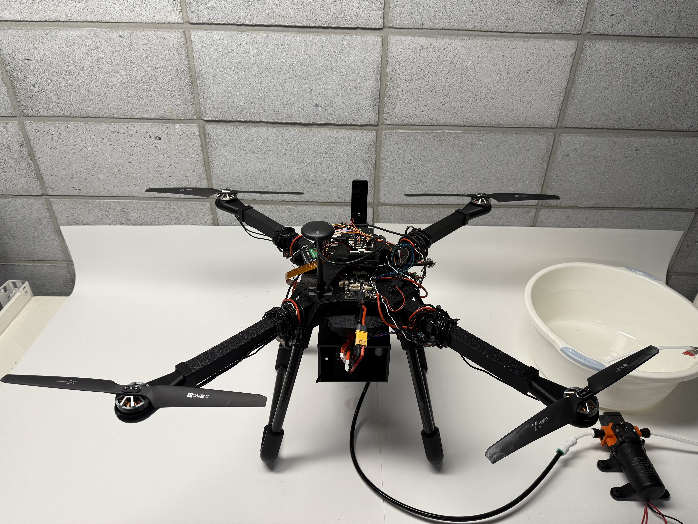
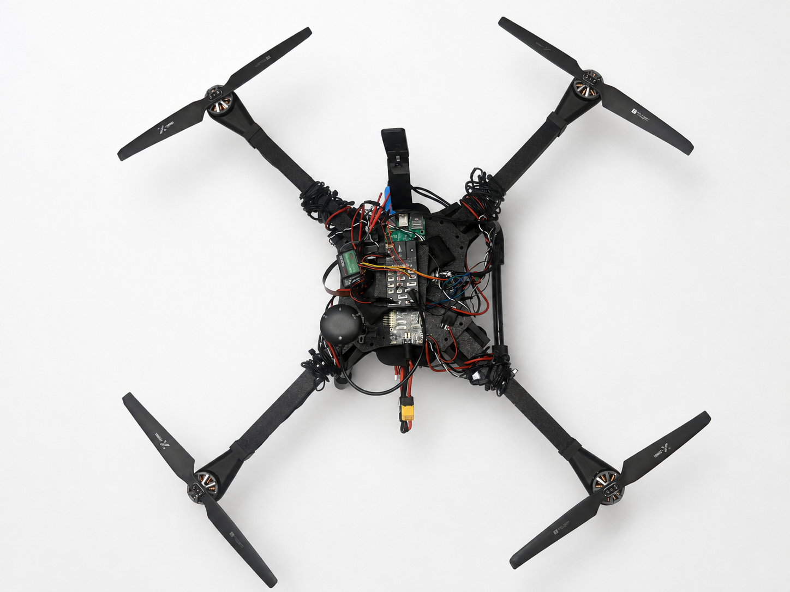
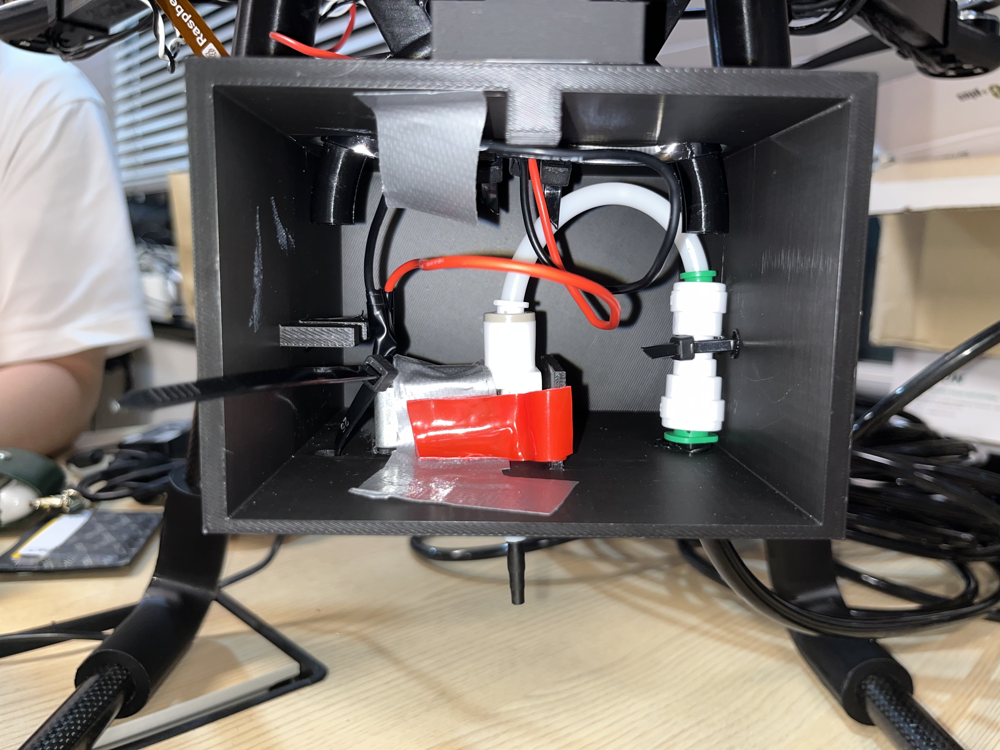
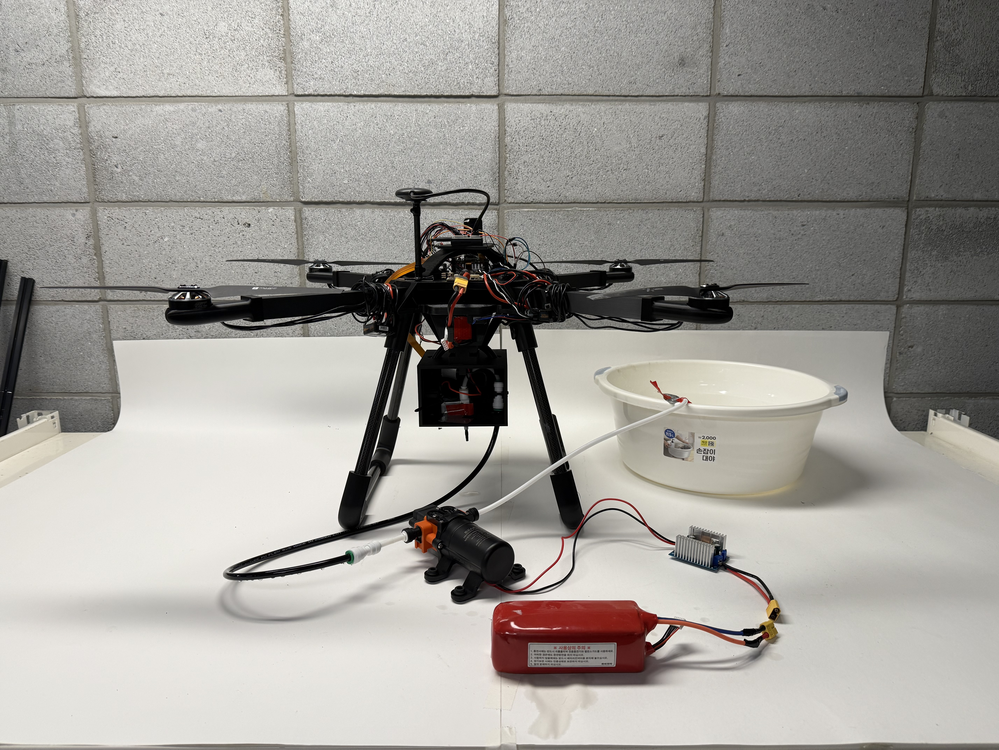
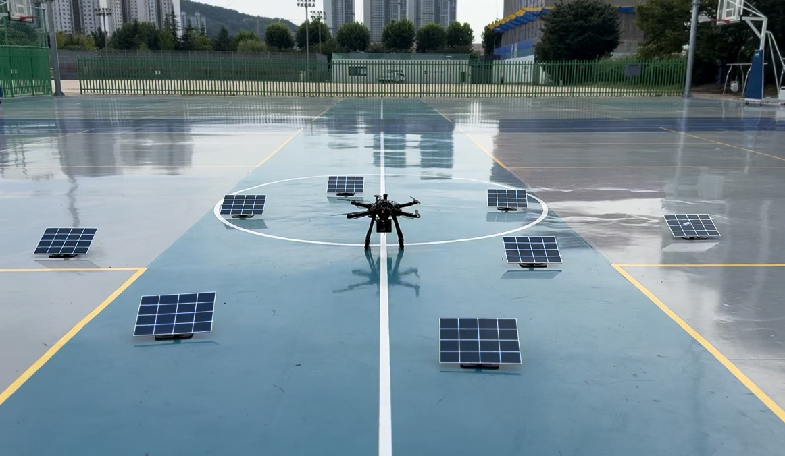
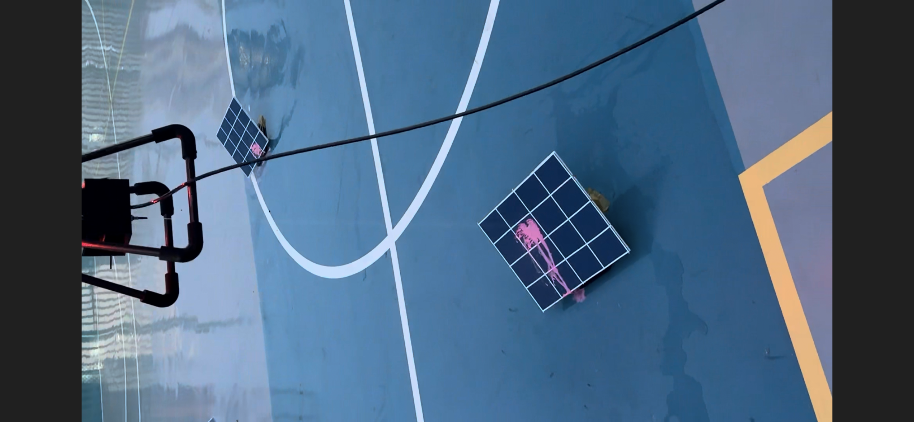
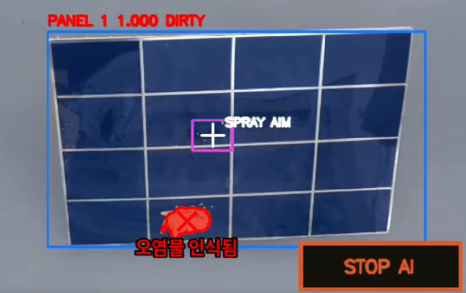

# L.E.O.N.A. 제작·시험 사진

[프로젝트 README](../../README.md) · [첨부 자료](../../docs/README.md)

## 기체 제작과 지상 급수

| 조립 기체 정면 | 조립 기체 상면 |
| --- | --- |
|  |  |

| 하부 분사 모듈 배관 | 지상 물탱크와 펌프 |
| --- | --- |
|  |  |

[급수 벤치 상면 사진](ground-water-bench-overhead.jpg)

## 야외 시험과 영상 인식

| 야외 시험 전경 | 기체 하부와 시험 패널 |
| --- | --- |
|  |  |

*인식 화면에는 패널, 오염 위치와 분사 조준점이 표시됩니다.*
